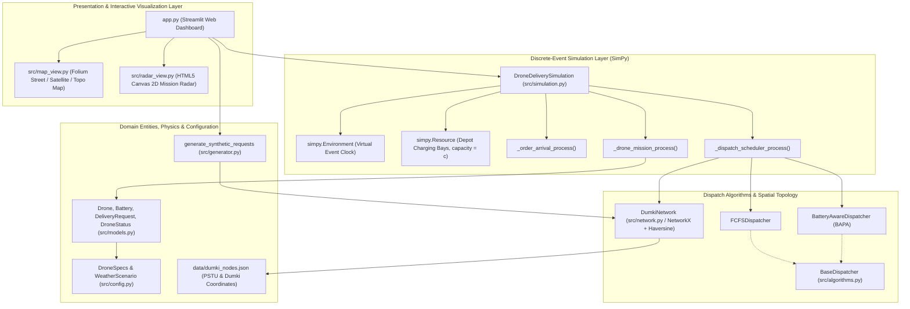
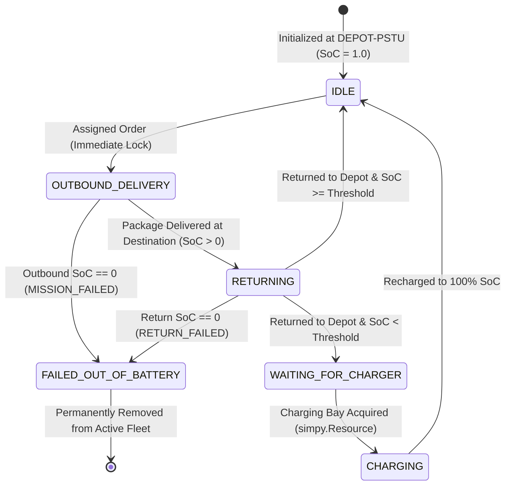

# CLIMATE-AWARE INTELLIGENT URBAN DRONE NETWORK

**Subtitle:** *An Integrated Simulation Framework for Battery-Aware Multi-Drone Delivery Optimization: A Case Study of Dumki, Patuakhali, Bangladesh*

---

## Title Page Information

| Field | Details |
| :--- | :--- |
| **Project Title** | Climate-Aware Intelligent Urban Drone Network |
| **Subtitle** | An Integrated Simulation Framework for Battery-Aware Multi-Drone Delivery Optimization: A Case Study of Dumki, Patuakhali, Bangladesh |
| **Course Title** | Simulation and Modeling |
| **Course Code** | `[Enter Course Code]` |
| **Student Name** | A.K.M. Tauhiduzzamana Nibir |
| **Student ID** | 2202033 |
| **Registration Number** | 11224 |
| **Academic Session** | 2022–2023 |
| **Level / Semester** | `[Enter Level / Semester]` |
| **Department** | Department of Computer Science and Engineering (CSE) |
| **Supervisor** | Dr. Md. Samsuzzaman Sobuz, Professor, CCE |
| **Co-supervisor** | Sarna Majumder, Associate Professor, CCE |
| **Institution** | Patuakhali Science and Technology University (PSTU), Dumki, Patuakhali-8602, Bangladesh |
| **Submission Date** | `[Enter Submission Date]` |

---

## Abstract

Unmanned Aerial Vehicles (UAVs) offer rapid point-to-point transport for urgent medical and campus supplies across riverine and semi-urban regions where road connectivity is circuitous. However, multi-rotor delivery drones operate under tight lithium-polymer (LiPo) battery constraints that degrade under heavy payloads, elevated ambient temperatures, and coastal headwinds. Naive dispatch policies that assign orders solely by arrival sequence risk mid-air battery depletion—particularly on the inbound return flight after payload delivery—while shared depot charging stations introduce queuing delays when multiple drones return simultaneously.

This project presents a pure software-based **Spatial-Temporal Discrete-Event Simulation (DES)** framework built with Python, SimPy, NetworkX, Folium, Plotly, and Streamlit, centered on the **Patuakhali Science and Technology University (PSTU) Main Campus (`DEPOT-PSTU`)** and ten campus and rural delivery nodes across **Dumki Upazila, Patuakhali, Bangladesh**. The framework models stochastic Poisson order arrivals, great-circle Haversine air corridors, payload-dependent aerodynamic power draw, an ambient temperature and headwind climate multiplier, and capacity-constrained depot charging bays ($M/G/c$-style resource contention via `simpy.Resource`). It compares a **Baseline First-Come, First-Served (`FCFSDispatcher`)** policy against a proposed **Battery-Aware and Payload-Constrained Assignment (`BatteryAwareDispatcher` / BAPA)** policy that pre-evaluates full round-trip energy expenditure against a mandatory $20\%$ State-of-Charge ($\text{SoC}$) safety reserve and selects the feasible drone leaving the smallest safe energy surplus.

Paired multi-seed computational experiments ($n = 5$ independent random seeds across Temperate, Moderate Summer, and Extreme Heatwave scenarios under two load regimes, totaling $60$ simulation runs and $1{,}800$ simulated orders) demonstrate that BAPA eliminates mid-air drone losses ($0$ outbound failures, $0$ return-leg failures, and $0$ safety-reserve violations across all runs). Under Extreme Heatwave stress conditions ($\kappa_{\text{climate}} = 1.405\times$, $N = 3$ drones, $\lambda = 10\text{ orders/hr}$, $35\%$ recharge threshold), FCFS suffers return-leg drone crashes on all five seeds—reducing round-trip mission success to $90.84\% \pm 12.49\%$ and inflating mean customer delivery time to $30.44 \pm 24.08\text{ min}$ due to fleet attrition—whereas BAPA achieves $97.70\% \pm 3.74\%$ mission and delivery completion within the $480\text{ min}$ horizon with $0$ lost drones and a $19.13 \pm 7.38\text{ min}$ mean delivery turnaround time.

---

## 1. Introduction and Motivation

Rapid delivery of emergency medical supplies (vaccines, blood bags, first-aid kits, diagnostic samples) and essential institutional logistics between a university hub and surrounding rural health posts is an increasingly studied application of autonomous multi-rotor UAV networks. In southern coastal Bangladesh—specifically **Dumki Upazila in Patuakhali District**—surface transport between the **PSTU Main Campus** and surrounding union clinics (such as Angaria, Pangashia, Muradia, and Lebukhali) relies on narrow rural roads and river-adjacent embankments, making short aerial corridors attractive for time-critical logistics.

Before any physical UAV network can be considered, **Simulation and Modeling** provides a safe, repeatable, zero-hardware-risk methodology to analyze system bottlenecks, fleet sizing, battery thresholds, and scheduling policies. Multi-drone delivery operations are inherently event-driven and stochastic:
1. Delivery requests arrive randomly over time with varying package masses and destinations.
2. Flight energy expenditure depends simultaneously on distance, payload mass, ambient thermal conditions, and wind resistance.
3. Returning drones compete for a finite number of electrical charging bays at the central hub, creating coupled dispatch-and-recharge queues.

An earlier exploratory prototype in this repository (`archive_legacy_heat_explorer/`) investigated synthetic urban heat visualization concepts; in the active system, thermal and coastal weather effects are integrated directly into the discrete-event flight-power model via parameterized ambient weather scenarios (`WeatherScenario`), enabling controlled evaluation of climate-induced battery derating on multi-drone scheduling.

---

## 2. Problem Statement

Given a central drone hub equipped with $N$ homogeneous multi-rotor drones and $c < N$ shared electrical charging bays serving a set of geographically distributed delivery locations under stochastic order arrivals and adverse ambient weather:

1. **Myopic Dispatch Hazard:** A naive First-Come, First-Served (FCFS) dispatcher assigns the oldest waiting request to the first idle drone at the depot without verifying whether the drone's current State-of-Charge ($\text{SoC}$) is sufficient to complete **both** the loaded outbound flight and the empty inbound return flight under current weather conditions.
2. **Return-Leg Attrition Paradox:** When drones recharge only if returning below a fixed threshold (e.g., $\text{SoC} < 0.50$ or $0.35$), a partially depleted drone may possess enough energy to reach a distant rural clinic and deliver its package, yet exhaust its battery to $0\%$ during the return journey. Counting only customer package drop-offs masks permanent vehicle loss and subsequent fleet capacity collapse.
3. **Charging Bay Contention:** When $N > c$, multiple drones returning below the recharge threshold must queue in First-In, First-Out (FIFO) order at the depot charging station, coupling dispatch decisions to future fleet availability.
4. **Concurrency Integrity:** In discrete-event scheduling, multiple requests present in the queue at the same simulation timestamp must never be assigned concurrently to the same physical drone.

---

## 3. Project Objectives

1. **Model a Real Geographic Hub-and-Spoke Topology:** Construct a spatial network centered on PSTU Main Campus (`DEPOT-PSTU`) with $10$ campus and regional delivery locations in Dumki Upazila using verified GPS coordinates and great-circle Haversine distances.
2. **Implement a Process-Oriented Discrete-Event Simulation Engine:** Build an event-driven simulator in **SimPy** modeling stochastic order arrivals, synchronous single-assignment dispatch locking, outbound loaded flight, payload drop-off, inbound empty return flight, and capacity-constrained depot recharging.
3. **Formulate Physics-Grounded Energy & Weather Models:** Couple payload-dependent hover/cruise power ($P_{\text{base}} + \alpha m$) with a parametric ambient temperature and headwind multiplier ($\kappa_{\text{climate}}$) and efficiency-adjusted charger duration equations.
4. **Design and Benchmark BAPA Against FCFS:** Implement the **Battery-Aware and Payload-Constrained Dispatcher (BAPA)** enforcing round-trip feasibility plus a $20\%$ $\text{SoC}$ safety reserve with a best-fit minimum-surplus selection heuristic, and compare it fairly against **FCFS** using identical seeded demand streams.
5. **Separate Customer Delivery Success from Round-Trip Mission Success:** Track outbound delivery failures, customer package deliveries, return-leg battery failures, and full round-trip mission completions without double-counting requests.
6. **Verify Correctness and Present Interactively:** Validate the codebase with an automated `pytest` regression suite and expose interactive controls, geographic maps, a 2D canvas mission radar, and live head-to-head benchmarking through a **Streamlit** web dashboard.

---

## 4. Scope and Limitations

### In Scope (Implemented and Verified)
- Pure software-based discrete-event simulation (`SimPy 4.1+`) of $2\text{--}8$ homogeneous drones operating from a single central depot (`DEPOT-PSTU`) with $1\text{--}4$ charging bays.
- Ten fixed delivery nodes across PSTU Campus and Dumki Upazila loaded from [`data/dumki_nodes.json`](file:///d:/Projects/Simulation/data/dumki_nodes.json) with Haversine corridor distances in [`src/network.py`](file:///d:/Projects/Simulation/src/network.py).
- Deterministic, seed-reproducible synthetic Poisson order generation in [`src/generator.py`](file:///d:/Projects/Simulation/src/generator.py).
- Comparative evaluation of `FCFSDispatcher` vs. `BatteryAwareDispatcher` in [`src/algorithms.py`](file:///d:/Projects/Simulation/src/algorithms.py).
- Automated unit and regression testing (`29` tests in `tests/`) and interactive visualization in [`app.py`](file:///d:/Projects/Simulation/app.py).

### Out of Scope (Explicit Non-Claims)
- **No Physical Hardware or Field Trials:** No physical UAV flights, hardware-in-the-loop tests, or real medical deliveries were conducted.
- **No Real Patient/Order Records or Live Telemetry:** All delivery demand streams (`arrival_time_min`, `package_weight_kg`, `urgency_deadline_min`) and weather scenario parameters are **synthetic** modeling inputs.
- **Direct Air Corridors Only (No Obstacle-Aware Multi-Hop Routing):** Although [`DumkiNetwork`](file:///d:/Projects/Simulation/src/network.py#L26-L73) stores nodes and edges in a `networkx.Graph`, flights traverse direct single-hop Haversine edges between `DEPOT-PSTU` and each destination node (`self.graph[origin_id][dest_id]["distance_km"]`). Multi-hop relay routing, no-fly-zone polygon avoidance, and obstacle-aware Dijkstra pathfinding are **not** implemented.
- **No Satellite Land Surface Temperature (LST) Ingestion in Active Engine:** Active weather scenarios use parameterized ambient air temperature ($T_{\text{ambient}}$) and headwind speed ($v_{\text{headwind}}$), not satellite raster LST feeds.

---

## 5. Study Area Description

The simulated service network covers **Dumki Upazila** in **Patuakhali District, Barisal Division, Bangladesh**, anchored at the **Patuakhali Science and Technology University (PSTU) Main Campus** ($22.4648^\circ\text{N}, 90.3835^\circ\text{E}$).

### Real Geographic Data vs. Synthetic Simulation Data
- **Real Geographic Component:** The latitude/longitude coordinates and institutional/regional identities of the central hub and $10$ delivery nodes in [`data/dumki_nodes.json`](file:///d:/Projects/Simulation/data/dumki_nodes.json) correspond to real landmarks within PSTU Campus and surrounding unions of Dumki Upazila, rendered over OpenStreetMap, Esri World Imagery, and OpenTopoMap tiles in [`src/map_view.py`](file:///d:/Projects/Simulation/src/map_view.py). Administrative boundary GeoJSON files are intentionally omitted unless externally verified (see [`data/boundaries/README.md`](file:///d:/Projects/Simulation/data/boundaries/README.md)).
- **Synthetic Component:** Order arrival timestamps, destination sampling (uniform random choice across the $10$ nodes), package masses ($0.5\text{--}2.5\text{ kg}$), urgency deadlines, drone hardware constants, and static weather scenario parameters are synthetic experimental inputs.

### Network Node Inventory and Corridor Distances from `DEPOT-PSTU`

All distances below are computed directly by `haversine_distance()` in [`src/network.py`](file:///d:/Projects/Simulation/src/network.py#L12-L24) ($R = 6371.0\text{ km}$, rounded to $3$ decimal places on graph edges):

| Node ID | Location Name | Zone | Node Type | Latitude ($^\circ\text{N}$) | Longitude ($^\circ\text{E}$) | Haversine Distance from `DEPOT-PSTU` ($\text{km}$) | One-Way Leg Time ($v=12\text{ m/s}$, $+60\text{ s}$) |
| :--- | :--- | :--- | :--- | :---: | :---: | :---: | :---: |
| `DEPOT-PSTU` | PSTU Central Drone Command & Charging Hub | Primary Hub | `central_hub` | 22.4648 | 90.3835 | 0.000 | — |
| `LOC-PSTU-MED` | PSTU Campus Medical Center & Emergency Post | PSTU Campus | `campus_clinic` | 22.4636 | 90.3820 | 0.204 | 1.28 min |
| `LOC-PSTU-CSE` | PSTU Faculty of CSE & Engineering Complex | PSTU Campus | `academic_faculty` | 22.4665 | 90.3846 | 0.220 | 1.31 min |
| `LOC-PSTU-HALLS` | PSTU Residential Halls (Keramat Ali & FMB) | PSTU Campus | `residential_hall` | 22.4622 | 90.3855 | 0.355 | 1.49 min |
| `LOC-PSTU-AGRI` | PSTU Agro-Research Farm & Botanical Garden | PSTU Campus | `research_farm` | 22.4682 | 90.3868 | 0.508 | 1.71 min |
| `LOC-DUMKI-HOSP` | Dumki Upazila Health Complex (Govt Hospital) | Dumki Regional | `regional_hospital` | 22.4530 | 90.3850 | 1.321 | 2.83 min |
| `LOC-DUMKI-BAZAR`| Dumki Central Bazar Logistics Point | Dumki Regional | `commercial_hub` | 22.4505 | 90.3780 | 1.688 | 3.34 min |
| `LOC-MURADIA` | Muradia Union Parishad Community Center | Dumki Regional | `rural_council` | 22.4850 | 90.4120 | 3.691 | 6.13 min |
| `LOC-LEBUKHALI` | Lebukhali Payra Bridge Highway Hub | Dumki Regional | `transit_gateway` | 22.4780 | 90.3450 | 4.219 | 6.86 min |
| `LOC-PANGASHIA` | Pangashia Rural Primary Health Post | Dumki Regional | `rural_clinic` | 22.4350 | 90.3520 | 4.632 | 7.43 min |
| `LOC-ANGARIA` | Angaria Union Council Post | Dumki Regional | `rural_council` | 22.4180 | 90.3950 | 5.336 | 8.41 min |

---

## 6. Existing Baseline System vs. Proposed Approach

| Dimension | Baseline System (`FCFSDispatcher`) | Proposed Approach (`BatteryAwareDispatcher` / BAPA) |
| :--- | :--- | :--- |
| **Order Queue Order** | First-Come, First-Served (`pending_orders` iteration order). | First-Come, First-Served scan with feasibility gating (infeasible orders remain queued while feasible subsequent orders can be served). |
| **Pre-Flight Energy Check** | **None.** Checks only `d.is_available()`, `d.current_node == depot_id`, `current_soc > 0`, and `package_weight_kg <= max_payload_kg`. | **Full Round-Trip Projection.** Computes exact loaded outbound energy + empty inbound return energy under active `climate_multiplier`. |
| **Safety Reserve Enforcement** | **None.** Can drain battery below $20\%$ $\text{SoC}$ or to $0\%$ mid-flight. | **Hard Reserve Constraint:** Requires $\text{SoC}_{\text{projected\_final}} \ge \text{SoC}_{\text{reserve}}$ ($0.20$). |
| **Drone Selection Heuristic** | **Index-Greedy:** Always picks `available_drones[0]` (the lowest-numbered idle drone). | **Best-Fit Minimum Surplus:** Selects the feasible drone minimizing $(\text{SoC}_i - \Delta\text{SoC}_{\text{trip}})$, preserving $100\%$-charged drones for long rural missions. |
| **Failure Mode Under Heatwave** | Depletes battery on return legs from distant nodes (`RETURN_FAILED`), permanently losing fleet capacity. | Holds infeasible orders at depot until a sufficiently charged drone is available; zero mid-air losses. |

---

## 7. System Architecture

The software follows a modular four-layer architecture separating configuration/data models, spatial and dispatch logic, the SimPy discrete-event kernel, and the Streamlit visualization frontend:

---

## 8. Simulation Methodology

### Discrete-Event Execution Paradigm
Unlike fixed-frame animation loops or real-time sleeps, [`DroneDeliverySimulation`](file:///d:/Projects/Simulation/src/simulation.py#L32-L280) uses **process-oriented Discrete-Event Simulation (DES)** via `simpy.Environment()`. Simulated time (`self.env.now`, measured in minutes) advances instantaneously between scheduled event timestamps, executing $8\text{ hours}$ ($480\text{ min}$) of fleet operations in well under one second.

### Concurrent SimPy Processes
1. **Order Arrival Process ([`_order_arrival_process`](file:///d:/Projects/Simulation/src/simulation.py#L81-L88)):** Sorts requests chronologically by `arrival_time_min`, yields `env.timeout(wait_time)` until each arrival instant, appends the order to `self.pending_orders`, and logs `ORDER_ARRIVED`.
2. **Dispatch Scheduler Process ([`_dispatch_scheduler_process`](file:///d:/Projects/Simulation/src/simulation.py#L90-L109)):** Wakes every $1.0\text{ simulated minute}$ (`yield self.env.timeout(1.0)`), iterates over `list(self.pending_orders)`, queries `dispatcher.select_drone_for_request(...)`, and—upon match—**immediately locks** `selected_drone.status = DroneStatus.OUTBOUND_DELIVERY` and `selected_drone.current_request_id = req.request_id` before spawning `_drone_mission_process`. This synchronous lock prevents duplicate assignment when multiple orders are pending in the same simulation tick.
3. **Drone Mission Process ([`_drone_mission_process`](file:///d:/Projects/Simulation/src/simulation.py#L111-L227)):** Models an individual drone's lifecycle for a dispatched order:
   - **Outbound Flight:** Logs `MISSION_DISPATCH`, yields `env.timeout(leg_time_min)`, and discharges loaded outbound energy. If $\text{SoC}$ hits $0$, logs `MISSION_FAILED`, marks `DroneStatus.FAILED_OUT_OF_BATTERY`, records the request in `failed_orders` and `failed_missions`, and terminates.
   - **Package Drop-Off:** Updates `drone.current_node = dest_id`, marks `request.status = "DELIVERED"`, records `delivery_time_min`, appends to `completed_orders`, and logs `PACKAGE_DELIVERED`.
   - **Inbound Return Flight:** Sets `DroneStatus.RETURNING`, yields `env.timeout(leg_time_min)`, and discharges empty-payload return energy. If $\text{SoC}$ hits $0$, logs `RETURN_FAILED`, sets `DroneStatus.FAILED_OUT_OF_BATTERY`, and appends the request to `return_failures` and `failed_missions` (while keeping `completed_orders` untouched so customer delivery and vehicle loss are accounted distinctly without double-counting).
   - **Depot Recovery & Charging Queue:** Upon surviving return, updates `drone.current_node = depot_id`, increments `completed_missions`, and logs `RETURNED_TO_DEPOT`. If `current_soc < recharge_threshold_soc`, requests a slot from `self.charging_station` (`simpy.Resource(capacity=c)`), waits in FIFO queue (`WAITING_FOR_CHARGER`), recharges to $100\%$ (`CHARGING`), releases the bay, and transitions back to `DroneStatus.IDLE` (`DRONE_AVAILABLE`).

---

## 9. Mathematical Model and Equations

Every equation below corresponds directly to the implementation in `src/network.py`, `src/generator.py`, `src/config.py`, `src/models.py`, `src/algorithms.py`, and `src/simulation.py`.

### 9.1 Great-Circle Air Corridor Distance (Haversine Formula)
Implemented in [`haversine_distance`](file:///d:/Projects/Simulation/src/network.py#L12-L24):
$$a = \sin^2\left(\frac{\Delta \phi}{2}\right) + \cos(\phi_1)\cos(\phi_2)\sin^2\left(\frac{\Delta \lambda}{2}\right)$$
$$d_{\text{km}} = 2 R \cdot \operatorname{atan2}\left(\sqrt{a}, \sqrt{1 - a}\right)$$
- **Variables & Units:** $\phi_1, \phi_2$ = latitudes in radians; $\Delta\phi = \phi_2 - \phi_1$ ($\text{rad}$); $\Delta\lambda = \lambda_2 - \lambda_1$ ($\text{rad}$); $R = 6371.0\text{ km}$ (mean spherical Earth radius); $d_{\text{km}}$ = one-way corridor distance ($\text{km}$), stored on graph edges rounded to $3$ decimal places.
- **Assumption:** Unobstructed straight-line great-circle flight at constant cruise altitude without terrain elevation changes or no-fly-zone detours.

### 9.2 Stochastic Order Arrival Process (Homogeneous Poisson Process)
Implemented in [`generate_synthetic_requests`](file:///d:/Projects/Simulation/src/generator.py#L11-L47):
$$\Delta t_k \sim \text{Exponential}\left(\frac{\lambda_{\text{hr}}}{60}\right), \quad t_{\text{arrival}, k} = \sum_{j=1}^{k} \Delta t_j$$
- **Variables & Units:** $\lambda_{\text{hr}}$ = mean arrival rate ($\text{orders/hour}$); mean inter-arrival interval $\bar{\Delta t} = 60 / \lambda_{\text{hr}}$ ($\text{min}$); $t_{\text{arrival}, k}$ = arrival time of request $k$ ($\text{min}$), rounded to $0.01\text{ min}$.
- **Payload & Deadline Sampling:** $m_{\text{pkg}, k} \sim \mathcal{U}(0.5, 2.5)\text{ kg}$; $t_{\text{deadline}, k} = t_{\text{arrival}, k} + \mathcal{U}(45.0, 90.0)\text{ min}$.

### 9.3 Flight Leg Duration
Implemented in [`Battery.calculate_trip_energy_wh`](file:///d:/Projects/Simulation/src/models.py#L74-L75) and [`_drone_mission_process`](file:///d:/Projects/Simulation/src/simulation.py#L118):
$$T_{\text{leg, s}} = \frac{1000 \cdot d_{\text{km}}}{v_{\text{cruise}}} + t_{\text{maneuver}}, \qquad T_{\text{leg, min}} = \frac{T_{\text{leg, s}}}{60}, \qquad T_{\text{leg, hr}} = \frac{T_{\text{leg, s}}}{3600}$$
- **Variables & Units:** $v_{\text{cruise}} = 12.0\text{ m/s}$ ($43.2\text{ km/h}$); $t_{\text{maneuver}} = 60.0\text{ s}$ fixed vertical takeoff/landing overhead per flight leg.
- **Assumption:** Ground speed equals airspeed ($12.0\text{ m/s}$); headwind penalizes electrical power draw rather than reducing ground speed.

### 9.4 Climate Power Multiplier
Implemented in [`WeatherScenario.climate_multiplier`](file:///d:/Projects/Simulation/src/config.py#L34-L43):
$$\kappa_{\text{climate}} = \operatorname{round}\Big(1.0 + 0.015 \cdot \max(0.0,\; T_{\text{ambient}} - 28.0) + 0.030 \cdot v_{\text{headwind}},\; 3\Big)$$
- **Variables & Units:** $T_{\text{ambient}}$ = ambient air temperature ($^\circ\text{C}$); $v_{\text{headwind}}$ = representative wind speed ($\text{m/s}$); thermal coefficient $= 0.015\text{ }^\circ\text{C}^{-1}$ above $28.0^\circ\text{C}$; wind drag coefficient $= 0.030\text{ (m/s)}^{-1}$; $\kappa_{\text{climate}}$ = dimensionless power multiplier.

### 9.5 Payload-Dependent Flight Power and Leg Energy
Implemented in [`Battery.calculate_trip_energy_wh`](file:///d:/Projects/Simulation/src/models.py#L49-L78):
$$P_{\text{flight}}(m) = P_{\text{base}} + \alpha_{\text{payload}} \cdot m$$
$$E_{\text{leg}}(d_{\text{km}}, m) = P_{\text{flight}}(m) \cdot T_{\text{leg, hr}} \cdot \kappa_{\text{climate}}$$
- **Variables & Units:** $P_{\text{base}} = 210.0\text{ W}$ (unloaded hover/cruise power); $\alpha_{\text{payload}} = 45.0\text{ W/kg}$ (additional induced power per kilogram of cargo); $m \in [0, 2.5]\text{ kg}$ ($m = m_{\text{pkg}}$ outbound, $m = 0.0\text{ kg}$ inbound); $E_{\text{leg}}$ = electrical energy consumed on the leg ($\text{Wh}$).

### 9.6 State-of-Charge ($\text{SoC}$) Discharge and Recharge Dynamics
Implemented in [`Battery.discharge`](file:///d:/Projects/Simulation/src/models.py#L80-L89), [`Battery.recharge`](file:///d:/Projects/Simulation/src/models.py#L90-L96), and [`_drone_mission_process`](file:///d:/Projects/Simulation/src/simulation.py#L216-L223):
$$\text{SoC}_{\text{after}} = \max\left(0.0,\; \text{SoC}_{\text{before}} - \frac{E_{\text{leg}}}{C_{\text{batt}}}\right)$$
$$E_{\text{needed}} = C_{\text{batt}} \cdot (1.0 - \text{SoC}_{\text{return}}), \qquad T_{\text{charge, min}} = \frac{E_{\text{needed}}}{P_{\text{chg}} \cdot \eta_{\text{chg}}} \times 60$$
- **Variables & Units:** $C_{\text{batt}} = 180.0\text{ Wh}$ rated battery capacity; $\text{SoC} \in [0.0, 1.0]$ dimensionless fraction; $P_{\text{chg}} = 300.0\text{ W}$ charger output; $\eta_{\text{chg}} = 0.90$ charging efficiency ($P_{\text{eff}} = 270.0\text{ W}$, so a full $0\% \to 100\%$ charge takes $40.0\text{ min}$, and a $50\% \to 100\%$ charge takes $20.0\text{ min}$).
- **Survival Criterion:** `discharge()` returns `True` iff $\text{SoC}_{\text{after}} > 0.0$; reaching $0.0$ triggers mid-flight failure.

### 9.7 System Performance Metrics
Implemented in [`get_summary_metrics`](file:///d:/Projects/Simulation/src/simulation.py#L232-L280):
- **Customer Delivery Success Rate (\%):** $S_{\text{deliv}} = \frac{N_{\text{delivered}}}{N_{\text{total}}} \times 100\%$
- **Round-Trip Mission Success Rate (\%):** $S_{\text{mission}} = \frac{N_{\text{completed\_missions}}}{N_{\text{total}}} \times 100\%$
- **Average Delivery Turnaround Time ($\text{min}$):** $\bar{T}_{\text{deliv}} = \frac{1}{N_{\text{delivered}}} \sum_{r \in \mathcal{C}} (t_{\text{delivered}, r} - t_{\text{arrival}, r})$
- **Total Charging Queue Wait ($\text{min}$):** $W_{q, \text{total}} = \sum_{i=1}^{N} W_{q, i}$, where $W_{q, i} = \sum (t_{\text{bay\_acquired}} - t_{\text{queue\_enter}})$
- **Fleet Flight Utilization (\%):** $U_{\text{fleet}} = \min\left(100,\; \frac{\sum_{i=1}^{N} T_{\text{flight}, i}}{N \cdot T_{\text{sim}}} \times 100\%\right)$

---

## 10. Drone, Battery, Charging, Delivery, and Weather Models

### 10.1 Standardized Drone Hardware (`DroneSpecs`)
Defined as a frozen dataclass in [`src/config.py`](file:///d:/Projects/Simulation/src/config.py#L13-L25):
- Cruising speed: $12.0\text{ m/s}$ ($43.2\text{ km/h}$)
- Takeoff/landing maneuver overhead: $60.0\text{ s}$ per leg
- Battery capacity: $180.0\text{ Wh}$
- Base unloaded power: $210.0\text{ W}$; payload power coefficient: $45.0\text{ W/kg}$; maximum payload: $2.5\text{ kg}$
- Safety reserve threshold: $\text{SoC}_{\text{reserve}} = 0.20$ ($36.0\text{ Wh}$)
- Charger power: $300.0\text{ W}$ at $\eta = 0.90$ efficiency

### 10.2 Delivery vs. Mission Lifecycle Distinction
A central engineering contribution hardened in Phase 7.1 is separating **customer delivery status** (`DeliveryRequest.status`) from **vehicle round-trip mission status** (`DeliveryRequest.mission_status`):
1. **Delivery Success (`completed_orders`):** Package reaches `destination_node` (`status == "DELIVERED"`).
2. **Failed Delivery (`failed_orders`):** Drone depletes battery on the outbound leg prior to drop-off (`status == "FAILED"`, `mission_status == "OUTBOUND_FAILED"`). `completed_orders` and `failed_orders` are strictly disjoint sets—no order is ever counted in both.
3. **Return-Leg Failure (`return_failures` $\subset$ `failed_missions`):** Package is delivered (`status == "DELIVERED"`), but battery reaches $0.0$ on the empty return leg (`mission_status == "RETURN_FAILED"`, `drone.status = FAILED_OUT_OF_BATTERY`).
4. **Mission Success (`completed_missions`):** Package is delivered **and** the drone returns safely to `DEPOT-PSTU` (`mission_status == "COMPLETED"`).

### 10.3 Weather Scenarios & Important Thermal Modeling Distinction
Defined in [`WEATHER_SCENARIOS`](file:///d:/Projects/Simulation/src/config.py#L45-L64):

| Scenario Key | Scenario Name | $T_{\text{ambient}}$ ($^\circ\text{C}$) | $v_{\text{headwind}}$ ($\text{m/s}$) | $\kappa_{\text{climate}}$ |
| :--- | :--- | :---: | :---: | :---: |
| `Temperate (Spring/Winter)` | `Temperate` | 26.0 | 2.0 | **1.060x** |
| `Moderate Summer` | `Moderate Summer` | 32.0 | 4.0 | **1.180x** |
| `Extreme Monsoon / Heatwave` | `Extreme Heatwave` | 39.0 | 8.0 | **1.405x** |

> **Critical Physical Distinction — Land Surface Temperature (LST) vs. Ambient Air & Battery Temperature:**  
> Satellite remote-sensing products (such as Landsat thermal bands referenced in the archived prototype `archive_legacy_heat_explorer/`) measure **radiometric Land Surface Temperature (LST)**—the skin temperature of roofs, asphalt, soil, or canopy—which can exceed $45\text{--}55^\circ\text{C}$ under solar irradiance. **LST is not equal to ambient air temperature ($T_{\text{ambient}}$) at UAV cruise altitude ($30\text{--}80\text{ m}$ AGL), nor is it equal to internal LiPo cell temperature ($T_{\text{cell}}$)**, which is governed by convective air cooling and internal ohmic heating ($I^2 R_{\text{int}}$). Accordingly, the active simulation models $T_{\text{ambient}}$ ($26^\circ\text{C}\text{--}39^\circ\text{C}$) as an air-density and thermal-strain proxy via $\kappa_{\text{climate}}$ rather than feeding raw ground-skin LST directly into battery equations.

---

## 11. Dispatching Algorithms: FCFS vs. BAPA

### 11.1 Baseline: `FCFSDispatcher` ([`src/algorithms.py:25-53`](file:///d:/Projects/Simulation/src/algorithms.py#L25-L53))
1. Filters `fleet` for drones satisfying `d.is_available()`, `d.current_node == depot_id`, `d.battery.current_soc > 0.0`, and `0.0 <= request.package_weight_kg <= d.specs.max_payload_kg`.
2. Returns `available_drones[0]` (or `None` if empty) without estimating flight distance, weather penalty, or return-leg energy.
- **Time Complexity per Request:** $\mathcal{O}(N)$, where $N$ is fleet size.

### 11.2 Proposed: `BatteryAwareDispatcher` / BAPA ([`src/algorithms.py:54-122`](file:///d:/Projects/Simulation/src/algorithms.py#L54-L122))
1. Filters `fleet` for available idle drones at `depot_id` within payload capacity ($m_{\text{pkg}} \le 2.5\text{ kg}$).
2. Looks up corridor distance $d_{\text{km}}$ between `DEPOT-PSTU` and `request.destination_node`.
3. For each candidate drone $i$, computes:
   $$E_{\text{trip}, i} = E_{\text{outbound}}(d_{\text{km}}, m_{\text{pkg}}, \kappa_{\text{climate}}) + E_{\text{return}}(d_{\text{km}}, 0, \kappa_{\text{climate}})$$
   $$\text{SoC}_{\text{proj}, i} = \text{SoC}_i - \frac{E_{\text{trip}, i}}{C_{\text{batt}}}$$
4. Retains only feasible drones satisfying the hard safety reserve constraint:
   $$\text{SoC}_{\text{proj}, i} \ge \text{SoC}_{\text{reserve}} \quad (0.20)$$
5. If no candidate is feasible, returns `None` (keeping the order safely queued in `pending_orders` while allowing subsequent shorter/lighter orders in the queue to be checked).
6. Otherwise, sorts feasible candidates in ascending order of $\text{SoC}_{\text{proj}, i}$ and selects:
   $$i^* = \arg\min_{i \in \mathcal{F}} \text{SoC}_{\text{proj}, i}$$
   This **best-fit minimum safe surplus** rule dispatches moderately charged drones on short campus hops while conserving $100\%$-charged drones for long rural missions (e.g., `LOC-ANGARIA` at $5.336\text{ km}$).
- **Time Complexity per Request:** $\mathcal{O}(N \log N)$ due to candidate sorting.

---

## 12. Experimental Setup and Assumptions

To evaluate FCFS and BAPA reproducibly, [`results/run_benchmark_experiments.py`](file:///d:/Projects/Simulation/results/run_benchmark_experiments.py) executes paired experiments across **$5$ independent fixed random seeds** (`42, 101, 202, 303, 404`) and all **$3$ climate scenarios** (`Temperate`, `Moderate Summer`, `Extreme Heatwave`) under **two operational regimes** ($2 \times 3 \times 5 \times 2 = 60$ simulation runs):

1. **Regime 1 — `Standard_Default`:** Matches the exact default sliders of [`app.py`](file:///d:/Projects/Simulation/app.py#L68-L71): $N = 4$ drones, $c = 2$ charging bays, $25$ orders, $\lambda = 6.0\text{ orders/hr}$, `recharge_threshold_soc = 0.50`, horizon $= 480.0\text{ min}$.
2. **Regime 2 — `High_Load_Stress`:** Evaluates fleet contention and extended multi-sortie battery cycling using existing `DroneDeliverySimulation` parameters without modifying engine logic: $N = 3$ drones, $c = 2$ charging bays, $35$ orders, $\lambda = 10.0\text{ orders/hr}$, `recharge_threshold_soc = 0.35`, horizon $= 480.0\text{ min}$.

**Key Experimental Assumptions:**
- Identical request lists (`copy.deepcopy(base_requests)`) are supplied to FCFS and BAPA for every `(regime, weather, seed)` tuple.
- All drones begin at $t = 0.0\text{ min}$ at `DEPOT-PSTU` with $\text{SoC} = 1.0$ ($180.0\text{ Wh}$).
- Weather conditions remain constant throughout a $480.0\text{ min}$ run.
- Mid-air depleted drones (`FAILED_OUT_OF_BATTERY`) are not replaced during the run.

---

## 13. Experimental Results and Comparison Tables

All values below are exact outputs saved in [`results/benchmark_aggregated.csv`](file:///d:/Projects/Simulation/results/benchmark_aggregated.csv) and [`results/benchmark_per_seed.csv`](file:///d:/Projects/Simulation/results/benchmark_per_seed.csv).

### 13.1 Aggregated Multi-Seed Comparison ($n = 5$ Seeds: Mean $\pm$ SD)

| Regime | Weather ($\kappa_{\text{climate}}$) | Policy | Delivery Success (%) | Mission Success (%) | Return Failures | Reserve Violations ($\text{SoC}<20\%$) | Avg Delivery Time (min) | Total Energy (Wh) | Charging Wait (min) | Drone Util. (%) |
| :--- | :--- | :---: | :---: | :---: | :---: | :---: | :---: | :---: | :---: | :---: |
| `Standard_Default` | Temperate ($1.060\times$) | **FCFS** | $100.00 \pm 0.00$ | $100.00 \pm 0.00$ | $0.00 \pm 0.00$ | $0.60 \pm 0.89$ | $5.10 \pm 1.24$ | $812.94 \pm 38.34$ | $6.92 \pm 13.09$ | $9.98 \pm 0.50$ |
| `Standard_Default` | Temperate ($1.060\times$) | **BAPA** | $100.00 \pm 0.00$ | $100.00 \pm 0.00$ | $0.00 \pm 0.00$ | **$0.00 \pm 0.00$** | **$4.59 \pm 0.43$** | $812.94 \pm 38.34$ | **$3.75 \pm 6.31$** | $9.98 \pm 0.50$ |
| `Standard_Default` | Moderate Summer ($1.180\times$) | **FCFS** | $100.00 \pm 0.00$ | $100.00 \pm 0.00$ | $0.00 \pm 0.00$ | $1.20 \pm 1.10$ | $4.87 \pm 0.76$ | $904.97 \pm 42.68$ | $10.66 \pm 14.39$ | $9.98 \pm 0.50$ |
| `Standard_Default` | Moderate Summer ($1.180\times$) | **BAPA** | $100.00 \pm 0.00$ | $100.00 \pm 0.00$ | $0.00 \pm 0.00$ | **$0.00 \pm 0.00$** | **$4.85 \pm 0.71$** | $904.97 \pm 42.68$ | **$3.62 \pm 4.77$** | $9.98 \pm 0.50$ |
| `Standard_Default` | Extreme Heatwave ($1.405\times$) | **FCFS** | $100.00 \pm 0.00$ | $98.40 \pm 2.19$ | $0.40 \pm 0.55$ | $1.60 \pm 1.52$ | $5.45 \pm 1.57$ | $1077.53 \pm 50.82$ | $20.08 \pm 14.44$ | $9.98 \pm 0.50$ |
| `Standard_Default` | Extreme Heatwave ($1.405\times$) | **BAPA** | $100.00 \pm 0.00$ | **$100.00 \pm 0.00$** | **$0.00 \pm 0.00$** | **$0.00 \pm 0.00$** | **$5.42 \pm 1.45$** | $1077.53 \pm 50.82$ | **$17.74 \pm 6.41$** | $9.98 \pm 0.50$ |
| `High_Load_Stress` | Temperate ($1.060\times$) | **FCFS** | $100.00 \pm 0.00$ | $100.00 \pm 0.00$ | $0.00 \pm 0.00$ | $2.80 \pm 1.92$ | $13.13 \pm 3.03$ | $1132.44 \pm 76.01$ | $12.35 \pm 8.21$ | $18.45 \pm 1.40$ |
| `High_Load_Stress` | Temperate ($1.060\times$) | **BAPA** | $100.00 \pm 0.00$ | $100.00 \pm 0.00$ | $0.00 \pm 0.00$ | **$0.00 \pm 0.00$** | $13.54 \pm 2.66$ | $1132.44 \pm 76.01$ | $12.54 \pm 7.05$ | $18.45 \pm 1.40$ |
| `High_Load_Stress` | Moderate Summer ($1.180\times$) | **FCFS** | $100.00 \pm 0.00$ | $99.42 \pm 1.30$ | $0.20 \pm 0.45$ | $2.60 \pm 1.82$ | $15.79 \pm 2.16$ | $1260.64 \pm 84.61$ | $19.56 \pm 2.99$ | $18.45 \pm 1.40$ |
| `High_Load_Stress` | Moderate Summer ($1.180\times$) | **BAPA** | $100.00 \pm 0.00$ | **$100.00 \pm 0.00$** | **$0.00 \pm 0.00$** | **$0.00 \pm 0.00$** | **$15.33 \pm 2.50$** | $1260.64 \pm 84.61$ | **$11.93 \pm 8.85$** | $18.45 \pm 1.40$ |
| `High_Load_Stress` | Extreme Heatwave ($1.405\times$) | **FCFS** | $95.42 \pm 10.24$ | $90.84 \pm 12.49$ | $1.60 \pm 0.89$ | $3.80 \pm 0.84$ | $30.44 \pm 24.08$ | $1420.95 \pm 150.61$ | $11.41 \pm 10.94$ | $17.49 \pm 1.81$ |
| `High_Load_Stress` | Extreme Heatwave ($1.405\times$) | **BAPA** | **$97.70 \pm 3.74$** | **$97.70 \pm 3.74$** | **$0.00 \pm 0.00$** | **$0.00 \pm 0.00$** | **$19.13 \pm 7.38$** | $1429.37 \pm 129.93$ | **$11.22 \pm 10.57$** | $17.56 \pm 1.68$ |

### 13.2 Per-Seed Breakdown: Extreme Heatwave ($\kappa_{\text{climate}} = 1.405\times$)

#### A. `Standard_Default` ($N=4, c=2, 25\text{ orders}, \lambda=6/\text{hr}, \text{threshold}=50\%$)

| Seed | Policy | Delivered / 25 | Mission Success / 25 | Return-Leg Failures | Reserve Violations | Avg Turnaround (min) | Total Energy (Wh) | Charging Wait (min) |
| :---: | :---: | :---: | :---: | :---: | :---: | :---: | :---: | :---: |
| `42` | FCFS | 25 (100.0%) | 25 (100.0%) | 0 | 1 | 4.51 | 1028.03 | 16.93 |
| `42` | BAPA | 25 (100.0%) | 25 (100.0%) | 0 | 0 | 4.51 | 1028.03 | 16.93 |
| `101` | FCFS | 25 (100.0%) | 25 (100.0%) | 0 | 0 | 4.48 | 1102.02 | 23.44 |
| `101` | BAPA | 25 (100.0%) | 25 (100.0%) | 0 | 0 | 4.48 | 1102.02 | 7.27 |
| `202` | FCFS | 25 (100.0%) | **24 (96.0%)** | **1** | **4** | 6.26 | 1114.67 | 19.70 |
| `202` | BAPA | 25 (100.0%) | **25 (100.0%)** | **0** | **0** | 7.26 | 1114.67 | 21.27 |
| `303` | FCFS | 25 (100.0%) | 25 (100.0%) | 0 | 2 | 7.84 | 1125.45 | 40.33 |
| `303` | BAPA | 25 (100.0%) | 25 (100.0%) | 0 | 0 | 6.72 | 1125.45 | 24.04 |
| `404` | FCFS | 25 (100.0%) | **24 (96.0%)** | **1** | **1** | 4.14 | 1017.49 | 0.00 |
| `404` | BAPA | 25 (100.0%) | **25 (100.0%)** | **0** | **0** | 4.14 | 1017.49 | 19.19 |

#### B. `High_Load_Stress` ($N=3, c=2, 35\text{ orders}, \lambda=10/\text{hr}, \text{threshold}=35\%$)

| Seed | Policy | Delivered / 35 | Mission Success / 35 | Pending at $480\text{m}$ | Return-Leg Failures | Reserve Violations | Avg Turnaround (min) | Total Energy (Wh) | Charging Wait (min) |
| :---: | :---: | :---: | :---: | :---: | :---: | :---: | :---: | :---: | :---: |
| `42` | FCFS | **27 (77.1%)** | **24 (68.6%)** | **8** | **3 (All Drones Lost)** | 3 | 17.13 | 1198.21 | 19.01 |
| `42` | BAPA | **32 (91.4%)** | **32 (91.4%)** | 3 | **0** | **0** | **14.06** | 1327.62 | 19.01 |
| `101` | FCFS | 35 (100.0%) | **34 (97.1%)** | 0 | **1** | 4 | 20.81 | 1472.47 | 14.28 |
| `101` | BAPA | 35 (100.0%) | **35 (100.0%)** | 0 | **0** | **0** | **17.24** | 1472.47 | 10.00 |
| `202` | FCFS | 35 (100.0%) | **34 (97.1%)** | 0 | **1** | 4 | 26.04 | 1600.61 | 23.76 |
| `202` | BAPA | 35 (100.0%) | **35 (100.0%)** | 0 | **0** | **0** | 31.07 | 1600.61 | 1.21 |
| `303` | FCFS | 35 (100.0%) | **33 (94.3%)** | 0 | **2** | 5 | **72.90** | 1472.20 | 0.00 |
| `303` | BAPA | 35 (100.0%) | **35 (100.0%)** | 0 | **0** | **0** | **20.76** | 1472.20 | 24.74 |
| `404` | FCFS | 35 (100.0%) | **34 (97.1%)** | 0 | **1** | 3 | 15.34 | 1361.28 | 0.00 |
| `404` | BAPA | 34 (97.1%) | **34 (97.1%)** | 1 | **0** | **0** | **12.53** | 1273.94 | 1.13 |

---

## 14. Discussion and Interpretation

1. **Why Return-Leg Failures Dominate Over Outbound Failures:**  
   Even for the farthest node (`LOC-ANGARIA`, $5.336\text{ km}$) with maximum payload ($2.5\text{ kg}$) under `Extreme Heatwave` ($\kappa = 1.405\times$), the outbound leg requires $63.52\text{ Wh}$ ($35.3\%$ $\text{SoC}$) and the empty return leg requires $41.36\text{ Wh}$ ($23.0\%$ $\text{SoC}$), totaling $104.88\text{ Wh}$ ($58.3\%$ $\text{SoC}$). When `recharge_threshold_soc = 0.50`, every idle drone starts with $\text{SoC} \ge 50\%$ ($\ge 90\text{ Wh}$), guaranteeing outbound survival ($50\% - 35.3\% = 14.7\% > 0\%$), so customer packages reach their destinations (`delivered_orders = 25/25` in `Standard_Default`). However, a drone departing at $50\%\text{--}58\%$ $\text{SoC}$ runs out of energy on the return journey (`Seeds 202` and `404`). Separating **Delivery Success** from **Mission Success** exposes this critical operational failure that delivery-only metrics completely hide.
2. **Fleet Attrition Cascade Under Stress:**  
   In `High_Load_Stress` + `Extreme Heatwave`, FCFS loses drones on **all five seeds** ($8$ lost drones out of $15$ deployed across the $5$ runs). On `Seed 42`, all $3$ drones crash on return flights, stranding $8$ remaining customer requests indefinitely. On `Seed 303`, $2$ of $3$ drones crash, forcing the lone surviving drone to process the remaining backlog sequentially and driving average delivery time to $72.90\text{ min}$ versus $20.76\text{ min}$ under BAPA.
3. **Load-Spreading Benefit of BAPA's Best-Fit Rule:**  
   Because FCFS always picks `available_drones[0]`, `DRONE-01` is repeatedly dispatched until it crosses the recharge threshold, clustering charger demand. BAPA's minimum-safe-surplus heuristic assigns partially used drones to short PSTU campus hops (`0.20--0.51 km`, consuming $< 6\%$ $\text{SoC}$ round-trip) while preserving $100\%$ $\text{SoC}$ drones for $4\text{--}5.3\text{ km}$ rural trips, reducing average charging bay queue wait in `Standard_Default` across all three weather scenarios (`3.75 min` vs. `6.92 min` in Temperate; `3.62 min` vs. `10.66 min` in Moderate Summer; `17.74 min` vs. `20.08 min` in Extreme Heatwave).
4. **Finite-Horizon Queue Holding Trade-Off:**  
   On `High_Load_Stress` + `Extreme Heatwave` (`Seeds 42` and `404`), BAPA holds $3$ and $1$ late-arriving orders in `pending_orders` at the $480.0\text{ min}$ cutoff while drones finish charging (`97.70%` completion). This reflects BAPA's conservative safety contract: delaying delivery rather than risking an unrecoverable mid-air crash.

---

## 15. Limitations and Future Improvements

### Current System Limitations
1. **Direct Corridor Topology Only:** Air corridors are modeled as direct great-circle segments without no-fly zones, tall building/tree obstacles, or multi-hop relay waypoints.
2. **No Order Deadline Expiration:** Although `DeliveryRequest` includes `urgency_deadline_min`, `_dispatch_scheduler_process` does not yet transition overdue queued orders to an `EXPIRED` state.
3. **Symmetric Scalar Wind Multiplier:** `WeatherScenario.climate_multiplier` applies an identical scalar drag penalty on both outbound and inbound legs rather than computing vector dot-products between wind direction and flight heading (headwind outbound vs. tailwind return).
4. **Linear Constant-Power Battery & Charger Approximation:** Voltage sag at low $\text{SoC}$, non-linear CC-CV (Constant-Current / Constant-Voltage) LiPo taper charging above $80\%$ $\text{SoC}$, and dynamic internal cell temperature evolution are simplified to linear constant-efficiency equations.
5. **Visual Trajectory Easing in 2D Radar:** In [`src/radar_view.py`](file:///d:/Projects/Simulation/src/radar_view.py#L219-L224), canvas drone icons animate toward target coordinates using smooth frame easing (`speedFactor = 0.04`) driven by real SimPy event timestamps rather than exact linear fraction $(t - t_{\text{start}}) / T_{\text{leg}}$.

### Future Improvements
1. **Obstacle-Aware Graph Routing:** Introduce restricted airspace polygons (e.g., over Lebukhali highway bridge approaches or dense residential zones) and run `networkx.shortest_path` (Dijkstra / $A^*$) across intermediate corridor waypoints.
2. **Deadline-Aware Priority & Order Expiration:** Incorporate Earliest-Deadline-First (EDF) priority weighting alongside BAPA feasibility checks and expire orders exceeding `urgency_deadline_min`.
3. **Directional Wind Vector & CC-CV Battery Physics:** Model wind as a 2D vector $(v_w, \theta_w)$ affecting ground speed on outbound vs. return headings, coupled with two-stage CC-CV charging curves.
4. **Opportunity / Partial Charging:** Allow drones to undock once charged to the exact energy required for a waiting high-priority order rather than always recharging to $100\%$ $\text{SoC}$.

---

## 16. Conclusion

This project designed, hardened, verified, and benchmarked a discrete-event simulation framework for climate-aware multi-drone delivery centered on PSTU Main Campus and Dumki Upazila. By combining SimPy process synchronization, Haversine spatial corridors, payload-and-climate-adjusted battery discharge, depot charging bay contention, and explicit separation of customer delivery completion from round-trip vehicle recovery, the framework provides a transparent experimental testbed for UAV scheduling policies. Multi-seed experiments confirm that while naive FCFS scheduling performs adequately under mild conditions and generous recharge thresholds, severe coastal heatwaves and high order arrival rates trigger return-leg battery exhaustion and fleet attrition under FCFS—a failure mode completely prevented by the proposed Battery-Aware and Payload-Constrained Dispatcher (BAPA).

---

## 17. References

1. **SimPy Discrete-Event Simulation Library:** Team SimPy, *SimPy 4.1 Documentation — Process-Based Discrete-Event Simulation Framework in Python*, https://simpy.readthedocs.io/
2. **NetworkX Graph Library:** Hagberg, A. A., Schult, D. A., & Swart, P. J. (2008). "Exploring network structure, dynamics, and function using NetworkX." *Proceedings of the 7th Python in Science Conference (SciPy 2008)*, pp. 11–15.
3. **Great-Circle Geodesic Formulation:** Sinnott, R. W. (1984). "Virtues of the Haversine." *Sky and Telescope*, 68(2), 159.
4. **Multi-Rotor UAV Payload Energy Modeling:** Dorling, K., Heinrichs, J., Messier, G. G., & Magierowski, S. (2017). "Vehicle Routing Problems for Drone Delivery." *IEEE Transactions on Systems, Man, and Cybernetics: Systems*, 47(1), 70–85. (Conceptual basis for linear mass-dependent multi-rotor power modeling).
5. **Discrete-Event Simulation & Queuing Methodology:** Law, A. M. (2015). *Simulation Modeling and Analysis* (5th ed.). McGraw-Hill Education.
6. **Interactive Visualization & Mapping Stack:**
   - Streamlit Documentation: https://docs.streamlit.io/
   - Folium / Leaflet.js Basemaps (OpenStreetMap Contributors, Esri World Imagery, OpenTopoMap): https://python-visualization.github.io/folium/
   - Plotly Python Graphing Library: https://plotly.com/python/
